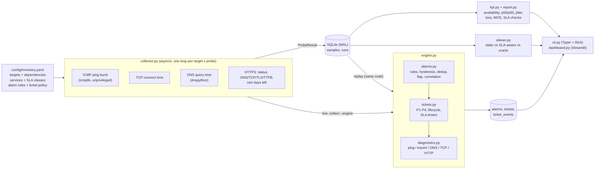

# noc-pulse

[](https://github.com/RutuK2005/noc-pulse/actions/workflows/ci.yml)

A small **service-assurance / NOC toolkit written only in Python**. It actively probes a set of
"customer services", turns the raw measurements into the KPIs a NOC watches (availability,
p50/p95 latency, jitter, packet loss, an ITU-T E-model voice MOS), raises alarms with
hysteresis and **dependency-based root-cause correlation**, opens **ITIL-style incident
tickets** with P1-P4 priority, SLA timers and auto-attached L1 diagnostics, and runs an
**SD-WAN path-selection simulation** over the measured data.

It was built as a portfolio project for a Service Assurance / NOC graduate role, so the
emphasis is on doing a few things correctly and explaining them honestly. Every number in
the results section below comes from the overnight run described there; how each one was
produced is listed in [`docs/FACTS.md`](docs/FACTS.md). A teaching guide (networking from
zero, ITIL, formulas with worked examples, interview questions) is in
[`docs/LEARN.md`](docs/LEARN.md).

> Stack: Python 3.11+ (developed on 3.14, CI on 3.12 and 3.13), asyncio, icmplib, dnspython,
> SQLite, Typer + Rich (CLI), Streamlit + pandas (dashboard), pytest, ruff, GitHub Actions.
> No JavaScript/TypeScript/Java.

---

## Why: what a NOC / service-assurance engineer does, and where it lives here

| NOC task | In noc-pulse |
|---|---|
| Watch customer KPIs on a dashboard | `noc-pulse report`, `noc-pulse dashboard` (Streamlit) |
| Know which customer services a box failure affects | inventory with services, SLA classes and a dependency tree (`config/inventory.yaml`) |
| Don't get paged for one lost packet | hysteresis: raise after N bad samples, clear after M good (`alarms.py`) |
| A site router dies and 20 alarms fire | correlation: children of a down parent are suppressed and linked to one root-cause alarm |
| Open and prioritise a ticket | impact x urgency matrix -> P1-P4, response/resolve SLA timers, lifecycle New -> Acknowledged -> In Progress -> Resolved -> Closed (`tickets.py`) |
| First-line triage | auto-diagnostics on ticket open: ping, tracert, DNS via two resolvers, TCP port check, HTTP check, one-line hypothesis (`diagnostics.py`) |
| Report MTTA / MTTR and SLA breaches | `noc-pulse tickets`, `report.py` |
| Voice quality complaints | E-model R-factor -> MOS from latency, jitter and loss (`kpi.py`) |
| SD-WAN application-aware routing | static primary vs SLA-aware steering with hold-down over real measured series (`sdwan.py`) |

## Architecture



* **One code path for live and history.** `Engine.process(sample)` is called by the collector
  in live mode and by `noc-pulse replay` over stored samples (the sample timestamp is the
  clock), so the overnight data was alarmed and ticketed by exactly the code that runs live.
* **Raw first.** The collector only stores raw samples; KPIs are computed at report time, so a
  formula fix never needs re-collection.
* **Polite.** External targets cannot be probed more than once per 30 s per probe type (the
  inventory loader rejects it). The overnight run used 30 s for ping bursts and 60 s for DNS,
  TCP and HTTPS, one GET per minute per site (status line only, then close).

## Inventory used for the real run

```
site-gw (home Wi-Fi router, ping)                          <- "site gateway / CPE"
 |-- dns-site (OS resolver, DNS query)                      <- "site DNS"
 |     |-- web-tatacomm   https://www.tatacommunications.com/  (HTTPS + TCP 443)
 |     |-- web-google     https://www.google.com/              (HTTPS + TCP 443)
 |     |-- web-cloudflare https://www.cloudflare.com/          (HTTPS + TCP 443)
 |     '-- web-wikipedia  https://www.wikipedia.org/           (HTTPS + TCP 443)
 |-- wan-cloudflare 1.1.1.1 (ping, DNS, TCP 443)            <- "transit / WAN path a"
 |-- wan-google     8.8.8.8 (ping, DNS, TCP 443)            <- "WAN path b"
 '-- wan-quad9      9.9.9.9 (ping, DNS, TCP 443)            <- "WAN path c"
```

Five fictional customer services sit on top (`acme-dia` silver, `acme-voice` gold,
`acme-dns` silver, `portal-tatacomm` bronze, `saas-web` bronze); see
[`config/inventory.yaml`](config/inventory.yaml).

## How each KPI is computed

| KPI | Definition used here | Code |
|---|---|---|
| Availability % | successful samples / samples, per target x probe. A ping sample is "up" if at least one of its 10 echoes came back; HTTP is up on 2xx/3xx. For a *service*, per minute: a minute is up only if every probe of every member target succeeded in it. | `kpi.availability_pct`, `report.service_availability` |
| Latency p50 / p95 | percentile with linear interpolation (same as `numpy.percentile` default). Ping: over every individual echo RTT. TCP: connect time. DNS: query time. HTTP: time to first byte including DNS + TCP + TLS. | `kpi.percentile` |
| Jitter | mean absolute difference of consecutive RTTs inside one 10-echo burst (echoes 200 ms apart): the "mean deviation of D" that the RFC 3550 estimator `J += (abs(D) - J)/16` smooths. The RFC 3550 estimator itself is implemented and tested too. | `kpi.mean_abs_delta`, `kpi.rfc3550_jitter` |
| Packet loss % | (echoes sent - echoes received) / echoes sent | `kpi.loss_pct` |
| R-factor / MOS | simplified ITU-T G.107 E-model, G.711 assumptions: `d = RTT/2 + 2*jitter + 20 ms`; `Id = 0.024 d + 0.11 (d - 177.3) H(d - 177.3)` (Cole & Rosenbluth 2001); `Ie,eff = Ie + (95 - Ie) * Ppl / (Ppl + Bpl)` with Ie = 0, Bpl = 25.1 (G.711 with PLC, as commonly cited from ITU-T G.113 App. I); `R = 93.2 - Id - Ie,eff`; `MOS = 1 + 0.035 R + R (R - 60)(100 - R) 7e-6` (G.107 Annex B), clamped to [1, 4.5]. | `kpi.r_factor`, `kpi.mos_from_r` |
| SLA breach | each service's KPIs vs its class policy (availability min, p95 max, jitter max, loss max; MOS min only for voice services) | `kpi.evaluate_sla` |
| MTTA / MTTR | mean(acknowledged - opened) / mean(resolved - opened) over tickets that reached that state | `tickets.mtta_s`, `tickets.mttr_s` |

Worked examples for every formula are in [`docs/LEARN.md`](docs/LEARN.md#formulas-with-worked-examples)
and the same numbers are asserted in `tests/test_kpi.py`.

## Real results

### Fault-injection demo (`noc-pulse demo`, 23 Nov 2026; full output in `results/fault_demo/`)

| Scenario | Alarms | Tickets | Detect | Time to ack | Ticket open -> resolved |
|---|---:|---:|---:|---:|---:|
| Edge router down (all three lab services behind it fail) | 3 raised, 2 suppressed as downstream of the edge | 1 (P1) | 8.0 s | 5.1 s | 14.0 s |
| Web app down only (edge healthy) | 1 | 1 (P2) | 9.8 s | - | 10.0 s |

Probe interval 2 s; raise after 3 bad samples, clear after 2 good. All lab targets are local listeners on 127.0.0.1.

### Live run (real public targets)

The collector runs against the targets in `config/inventory.yaml` (ping every 30 s, DNS/TCP/HTTPS every 60 s).
A first snapshot (23 Nov 2026, 23:36-00:01, 564 samples, 1,960 ICMP echoes) had every service at 100% availability
and voice MOS 4.34-4.40 on the measured links. Longer-run KPIs will be added when the overnight run is reported.

## Quick start

```bash
git clone https://github.com/RutuK2005/noc-pulse && cd noc-pulse
python -m venv .venv && . .venv/bin/activate      # Windows: .venv\Scripts\activate
pip install -e ".[dev,dashboard]"

noc-pulse probe                                  # every probe once, printed as a table
noc-pulse collect --duration 8h --keep-awake     # raw samples -> data/noc.db
noc-pulse replay                                 # alarms + correlation + tickets over the samples
noc-pulse report --markdown results/report.md    # coverage, per-target KPIs, services vs SLA
noc-pulse sdwan --json results/sdwan.json        # static vs SLA-aware path selection
noc-pulse tickets                                # ticket list with SLA timers, MTTA/MTTR
noc-pulse tickets show INC000001                 # worklog + auto-diagnostics
noc-pulse tickets ack INC000001 --note "L1 looking"
noc-pulse alarms --active
noc-pulse diagnose web-tatacomm                  # L1 diagnostics for one target now
noc-pulse demo                                   # fault-injection demo on 127.0.0.1
noc-pulse dashboard                              # Streamlit UI on http://localhost:8501
```

`collect --engine` runs alarms, tickets and auto-diagnostics live on every sample.
Invalid ticket transitions are rejected, e.g. `noc-pulse tickets start INC000001` on a
Closed ticket prints `rejected: INC000001: Closed -> In Progress is not allowed` (exit code 2).

## Fault-injection demo (end to end)

`noc-pulse demo` starts three local listeners - an "edge router" (TCP 18081), a web app
(HTTP 18080) and an API (TCP 18082), where the app and API depend on the edge - and runs
the collector with the live engine (2 s probe interval, raise after 3 bad, clear after 2
good, 4 s correlation window):

1. **Edge failure**: all three listeners are stopped. One root-cause alarm on the edge opens a
   **P1** ticket (impact high: three services affected; urgency high: critical alarm) with
   auto-diagnostics attached; the app and API alarms are **suppressed and linked** to the
   root cause, so only one ticket is opened. A scripted L1 operator acknowledges and starts
   work, the listeners come back, the alarm clears, the ticket auto-resolves, the operator
   closes it.
2. **Application-only failure**: only the web app is stopped while the edge is healthy. Its
   alarm is *not* suppressed (its parent is fine) and gets its own **P2** ticket.

DEMO_PLACEHOLDER

## Dashboard

`noc-pulse dashboard` (Streamlit, pure Python) shows: headline metrics (data span, samples,
ICMP echoes, active alarms, open tickets), customer services vs SLA, per-series latency /
jitter / loss / availability charts, the per-target KPI table, alarms, tickets with worklog
and diagnostics, and the SD-WAN comparison.

## Tests and CI

`pytest` runs without network access. 90 tests cover: percentile, jitter
(mean deviation and the RFC 3550 estimator, hand-computed), loss, the E-model and MOS
against worked examples, SLA evaluation, ping-output parsing (Windows and Linux), rule
evaluation, hysteresis, de-duplication, flapping, parent/child and same-target correlation,
the correlation window, the ticket state machine (valid and invalid transitions), priority
matrix, SLA timers and breaches, MTTA/MTTR, the engine end to end, replay determinism,
SD-WAN bucketing and the three policies (brown-out, hard-down, hold-down anti-flapping),
and inventory validation (cycles, unknown dependencies, the politeness floor).
GitHub Actions runs ruff and pytest on Python 3.12 and 3.13.

## Project layout

```
config/inventory.yaml        real targets, services, SLA classes, rules, ticket policy, SD-WAN paths
config/demo_inventory.yaml   localhost lab for the fault-injection demo
src/noc_pulse/
  inventory.py   YAML -> dataclasses, validation, dependency graph, impact
  probes.py      asyncio ping / TCP / DNS / HTTPS probes -> ProbeResult
  collector.py   drift-free scheduler, keep-awake, heartbeat
  store.py       SQLite schema and queries
  kpi.py         percentiles, jitter, loss, E-model, SLA checks
  alarms.py      rules, hysteresis, dedup, flap, correlation
  tickets.py     priority matrix, lifecycle, SLA timers, MTTA/MTTR
  diagnostics.py L1 auto-diagnostics
  engine.py      samples -> alarms -> tickets (live and replay)
  sdwan.py       path-selection simulation
  report.py      coverage, KPI and SLA reports, Markdown output
  faultdemo.py   the fault-injection scenario
  cli.py         Typer CLI;  dashboard.py  Streamlit UI
tests/           pytest suite (no network)
results/         committed outputs of the real run and the demo
docs/LEARN.md    teaching guide + interview prep;  docs/FACTS.md  CV-safe facts with provenance
```

## Honest limitations

* **One vantage point.** All measurements come from one Windows laptop on home Wi-Fi and one
  consumer broadband line, over one night. Wi-Fi and the home router are inside every
  measurement; this is not a carrier network and the numbers say nothing about any provider's
  network as a whole.
* **The SD-WAN part is a simulation.** The three "WAN paths" are three anycast destinations
  (1.1.1.1, 8.8.8.8, 9.9.9.9) reached over the *same* access line, so their failures are
  correlated; a real branch would have independent circuits (MPLS, broadband, LTE). The
  latency thresholds are compared with RTT (stricter than the usual one-way figures), and
  with 20 echoes per path per minute the smallest visible loss is 5 %.
* **ICMP is a proxy.** Routers and anycast services may rate-limit or deprioritise ICMP;
  ping RTT is not application latency (that is why TCP, DNS and HTTPS are also measured).
* **Jitter and MOS are estimates.** Jitter is two-way (from RTTs), not one-way RTP jitter.
  MOS assumes G.711, a 2 x jitter de-jitter buffer and 20 ms packetisation, uses RTT/2 as
  one-way delay and treats loss as random. Bpl = 25.1 is the commonly cited G.113 Appendix I
  value for G.711 with PLC; it is a parameter and should be checked against the
  Recommendation.
* **Sampling limits.** Availability is sample-based: an outage shorter than the probe
  interval (30-60 s) can be missed, and nothing is measured while the PC is off or asleep
  (gaps are counted in the report).
* **Overnight alarms/tickets come from `replay`**, i.e. the same engine run over the stored
  samples after collection, not from a live engine during the night. Auto-diagnostics cannot
  run for the past, and there are no human acknowledgements in a replay, so MTTA is only
  demonstrated in the fault-injection demo.
* **The demo is scripted on localhost.** Its times (seconds) prove the pipeline end to end;
  they are not an operational MTTR. In the lab the "edge router" is a listener on the same
  PC, so ICMP to it still answers and the diagnostics hypothesis reads "port refused".
* **Not production-grade ticketing.** Alarm-engine state is in memory (a restart forgets
  active alarms; tickets are persisted); no assignment groups, escalation, notifications,
  business-hours calendars or "stop the clock" for pending-customer time.
* **No device telemetry.** No SNMP, syslog/traps, NetFlow or streaming telemetry, no BGP/MPLS
  visibility - only active probes from the edge.
* **Live vs replay timing.** Samples are timestamped when a probe starts but processed
  live when it finishes (up to ~10 s later), so the order of near-simultaneous events can
  differ slightly between a live run and a replay of the same data.
* **Small-scale storage.** SQLite with a single writer is right for one collector, not for a
  fleet; the dashboard has no authentication (local use).

## License

MIT
